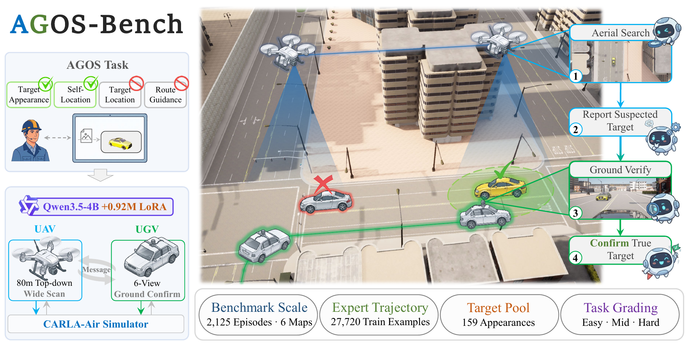

<p align="right"><a href="README.zh-CN.md"></a></p>

<h1 align="center">Towards Embodied Air-Ground Cooperative Object Search: Benchmark, Dataset and Agentic Method</h1>

<p align="center">
  <a href="https://arxiv.org/abs/2609.08402"></a>
  <a href="https://huggingface.co/datasets/Yomier/AGOS-Dataset"></a>
  <a href="https://modelscope.cn/datasets/Yomier/AGOS-Dataset"></a>
  <a href="https://huggingface.co/Qwen/Qwen3.5-4B"></a>
  <a href="https://github.com/louiszengCN/CarlaAir"></a>
</p>

<p align="center"></p>

A UAV and a ground vehicle search an urban region for the vehicle in a reference image. The UAV surveys the region and shares candidates. The ground vehicle approaches and confirms the matching instance using its own cameras in the same CARLA-Air world.

[Benchmark](benchmark/README.md) · [Dataset](dataset/README.md) · [Agent configurations](agents/README.md) · [CARLA-Air integration](carlaair/README.md) · [Deployment guide](docs/deployment.md)

## Highlights

- **AGOS-Bench** evaluates aerial discovery and ground confirmation in one episode. Success requires a correct UGV `CONFIRM` within 30 m, with line of sight and target visibility. Nine metrics distinguish search, cooperation and verification outcomes. [Metrics](benchmark/METRICS.md)
- **AGOS-Dataset** contains **2,125 tasks across six maps**, independent replay certification, and **27,720 training examples from 1,100 expert trajectories**. [Splits and data format](dataset/README.md)
- **AGOS-Agent** uses joint coverage planning and event-triggered multimodal decisions. With Qwen3.5-4B on Unseen-Test300, **Baseline-Agent scored 30.67%, AGOS-Agent zero-shot scored 37.67%, and joint LoRA reached 57.00%** (+19.33 percentage points over AGOS-Agent zero-shot). [Evaluation and inference](#evaluation-and-inference)
- **Minimal-Agent** is the direct multimodal control. It scored **15.33%** SR with Qwen3.5-4B and runs with the simulator and a model endpoint. [Minimal-Agent setup and results](agents/README.md#minimal-agent)

## Installation

Use Ubuntu 22.04 x86_64 with an NVIDIA GPU for live simulation. For data verification and offline dry runs, any Python 3.10 environment can run the first block. Run the shell examples from the cloned repository.

```bash
git clone https://github.com/Yomier/AGOS-Bench.git
cd AGOS-Bench
conda create -y -n agos-cpu python=3.10 pip
conda activate agos-cpu
python -m pip install -e '.[dev,dataset]'
```

1. **Simulator.** Install the upstream Linux ZIP and its bundled CPython 3.10 SDK using the commands in the deployment guide. This creates the `carlaAir` environment and a shell session file for data, model and simulator paths. In the evaluation terminal activate `carlaAir` and run `python -m pip install -e '.[simulator,dev,dataset]'`. [CARLA-Air v0.1.7 install](docs/deployment.md#2-install-conda-and-the-official-linux-simulator)
2. **Perception.** In a separate terminal, run `conda create -y -n agos-perception python=3.12 pip`, `conda activate agos-perception`, and `python -m pip install -e '.[perception,dataset]'`. Download the pinned Grounding DINO, SigLIP 2 and SAM2.1 snapshots and start the bundled service. This step serves AGOS-Agent, Baseline-Agent and their ablations. [Snapshot and service commands](docs/deployment.md#7-start-the-shared-perception-service)
3. **Inference.** In another terminal, run `conda create -y -n agos-vllm python=3.12 pip`, `conda activate agos-vllm`, `python -m pip install 'vllm==0.28.0' 'transformers==5.16.1'`, and `python -m pip install -e '.[dataset]'` from the checkout. Serve the pinned Qwen3.5-4B snapshot, or use an image-capable OpenAI-compatible endpoint. [Serving commands and environment variables](docs/deployment.md#8-choose-how-the-agent-obtains-multimodal-decisions)

## Data and checkpoints

Download all six AGOS-Dataset volumes from Hugging Face (`main`) or ModelScope (`master`). Unseen-Test300 only needs `taskset-test300.tar.gz`. In each terminal, source the deployment session file or set the variables below from the checkout root. Use the same paths in the evaluation, inference and training terminals.

```bash
export AGOS_DATA_ROOT="${AGOS_DATA_ROOT:-$PWD/data}"
export AGOS_OUTPUT_ROOT="${AGOS_OUTPUT_ROOT:-$PWD/runs}"
export MODEL_ROOT="${MODEL_ROOT:-$PWD/weights}"
mkdir -p "$AGOS_DATA_ROOT" "$AGOS_OUTPUT_ROOT" "$MODEL_ROOT"
```

Choose one hub and run the command below. For the offline route, place the delivered `taskset-test300.tar.gz` in `$AGOS_DATA_ROOT`, then proceed to verification and extraction.

**Hugging Face**

```bash
python dataset/download.py --source hf --repo-id Yomier/AGOS-Dataset --revision main --volume taskset-test300 --directory "$AGOS_DATA_ROOT"
```

**ModelScope**

```bash
python -m pip install modelscope
python dataset/download.py --source modelscope --repo-id Yomier/AGOS-Dataset --revision master --volume taskset-test300 --directory "$AGOS_DATA_ROOT"
```

After downloading or copying the archive, verify its SHA-256 against the bundled list and extract it.

```bash
python dataset/verify.py --volume taskset-test300 --directory "$AGOS_DATA_ROOT" && \
  tar -xzf "$AGOS_DATA_ROOT/taskset-test300.tar.gz" -C "$AGOS_DATA_ROOT"
```

The volume roots below appear after extracting the corresponding archives. Download the Qwen3.5-4B base from its upstream model card. Obtain a joint LoRA checkpoint by running the training section below. The original experiment weights are outside the release scope. [Volume names and checksums](dataset/README.md#access-and-verification) · [Pinned base model download](docs/deployment.md#a-local-qwen35-4b)

```text
$AGOS_DATA_ROOT/
├── train1100/                      # 1,100 training tasks
├── validation275/                  # 275 validation tasks
├── seentest450/                    # 450 seen-city test tasks
├── test300/                        # 300 unseen-city test tasks
│   ├── manifest.json
│   ├── tasks.csv
│   └── dataset/Town03/
│       ├── lite_easy_00001_plan.json
│       └── images/
├── certification/                 # Independent evidence for all 2,125 tasks
└── trajectories-train1100/
    ├── rows.jsonl
    ├── episodes.csv
    └── images/
$MODEL_ROOT/
└── Qwen3.5-4B/                     # Upstream model snapshot
$AGOS_OUTPUT_ROOT/
└── checkpoints/qwen3.5-4b-agos-lora/
    ├── adapter/                    # Generated by training
    └── processor/
```

## Evaluation and inference

First check one real task. The dry run verifies the plan, reference images and navigation assets offline. On the Ubuntu simulator host, the same `menu_oracle` command without `--dry-run` checks deployment with zero model calls. [Simulator smoke test](docs/deployment.md#6-run-one-episode-with-zero-model-api-calls)

```bash
python -m benchmark.run_parallel_eval --data-root "$AGOS_DATA_ROOT" --split test300 --episode Town03/lite_easy_00001 --arm menu_oracle --workers 1 --run-dir "$AGOS_OUTPUT_ROOT/preflight" --dry-run
```

For model evaluation, use the `carlaAir` terminal with the deployment session sourced, the perception service running, and vLLM serving Qwen3.5-4B as `qwen3.5-4b`. The commands below evaluate all 300 tasks using one worker. For a pilot add `--episode Town03/lite_easy_00001` and use a separate run directory. [Worker profiles and resume](benchmark/README.md#model-evaluation)

```bash
# AGOS-Agent, zero-shot
AGOS_VLM_MODEL=qwen3.5-4b python -m benchmark.run_parallel_eval --data-root "$AGOS_DATA_ROOT" --split test300 --arm agos_b --profile local --workers 1 --run-dir "$AGOS_OUTPUT_ROOT/agos-zero"

# Baseline-Agent, zero-shot
AGOS_VLM_MODEL=qwen3.5-4b python -m benchmark.run_parallel_eval --data-root "$AGOS_DATA_ROOT" --split test300 --arm baseline_a --profile local --workers 1 --run-dir "$AGOS_OUTPUT_ROOT/baseline-zero"
```

After training, restart your own vLLM service with the adapter. Run the first command in the inference terminal and the evaluation and scoring commands in the `carlaAir` terminal. Use the same `AGOS_OUTPUT_ROOT` in both terminals. [Adapter serving and API configuration](docs/deployment.md#a-local-qwen35-4b)

```bash
# Inference terminal
python -m carlaair.serving.vllm --model-dir "$MODEL_ROOT/Qwen3.5-4B" --adapter "mixed=$AGOS_OUTPUT_ROOT/checkpoints/qwen3.5-4b-agos-lora/adapter"

# Evaluation terminal
AGOS_VLM_MODEL=mixed python -m benchmark.run_parallel_eval --data-root "$AGOS_DATA_ROOT" --split test300 --arm agos_b --profile local --workers 1 --run-dir "$AGOS_OUTPUT_ROOT/agos-sft"
python -m benchmark.paper_metrics "$AGOS_OUTPUT_ROOT/agos-sft"
```

Use `--arm minimal_agent` for the direct multimodal control. The scorer reads locked outcomes, excludes pending infrastructure failures and reports the nine metrics with their denominators. [Minimal-Agent](agents/README.md#minimal-agent) · [Scoring](benchmark/METRICS.md)

## Supervised fine-tuning

The reported joint LoRA experiment used **6,014 examples** admitted by the 5,120-token filter from 8,212 supplied examples across 301 episodes. The exact historical input is outside the release scope. The commands below apply the same rank-8, alpha-16 joint recipe to the released Train1100 trajectories. The admitted count and result depend on the corpus and processor. [Training recipe and historical settings](training/README.md#what-the-paper-trained-on)

After verifying and extracting `trajectories-train1100.tar.gz`, use a CUDA training environment with PyTorch and torchvision matching your driver. Run from the repository root with the data, model and output variables set as above.

```bash
python -m pip install -e '.[train]'
python -m training.corpus --input "$AGOS_DATA_ROOT/trajectories-train1100" --output "$AGOS_OUTPUT_ROOT/corpus"
python -m training.train --base "$MODEL_ROOT/Qwen3.5-4B" --data "$AGOS_OUTPUT_ROOT/corpus/mixed.jsonl" --out "$AGOS_OUTPUT_ROOT/checkpoints/qwen3.5-4b-agos-lora" --seed 20261027 --max-sequence-tokens 5120
```

## Citation and license

The revised manuscript is arXiv:2609.08402v2. The figure, split sizes and results above describe this revised experiment. Use the software citation for this checkout and the following BibTeX for the paper. [Software citation](CITATION.cff) · [arXiv 2609.08402v2](https://arxiv.org/abs/2609.08402v2)

```bibtex
@misc{yu2026agos,
  title     = {Towards Embodied Air-Ground Cooperative Object Search: Benchmark, Dataset and Agentic Method},
  author    = {Yu, Boao and Chen, Zimo and Rao, Junreng and Hu, Yue and Zhu, Zhengqiu and Zhao, Yong and Gao, Jianzhe and Zhu, Pengfei and Ju, Rusheng},
  year      = {2026},
  publisher = {arXiv},
  doi       = {10.48550/ARXIV.2609.08402},
  url       = {https://arxiv.org/abs/2609.08402v2}
}
```

AGOS-Bench code uses [Apache-2.0](LICENSE). AGOS-Dataset uses [CC BY 4.0](https://creativecommons.org/licenses/by/4.0/). CARLA-Air and upstream models retain their respective licenses.
