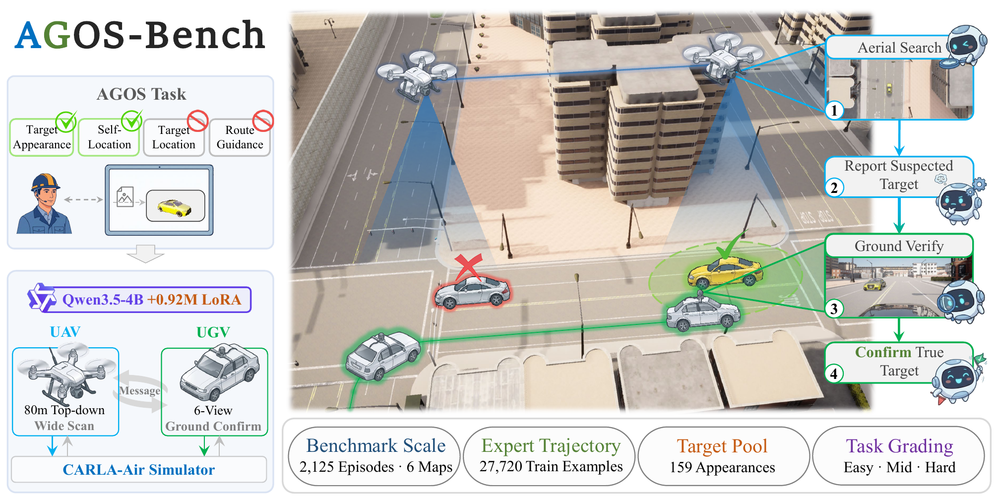

<p align="right"><a href="README.md"></a></p>

<h1 align="center">Towards Embodied Air-Ground Cooperative Object Search: Benchmark, Dataset and Agentic Method</h1>

<p align="center">
  <a href="https://arxiv.org/abs/2609.08402v1"></a>
  <a href="https://huggingface.co/datasets/Yomier/AGOS-Dataset"></a>
  <a href="https://modelscope.cn/datasets/Yomier/AGOS-Dataset"></a>
  <a href="https://huggingface.co/Qwen/Qwen3.5-4B"></a>
  <a href="https://github.com/louiszengCN/CarlaAir"></a>
</p>

<p align="center"></p>

UAV 和 UGV 根据一张参考图，在城市区域内协同寻找指定车辆。UAV 从空中搜索并共享候选目标，UGV 驶近候选目标，通过自身摄像头确认车辆是否与参考图匹配。两个智能体在同一个 CARLA-Air 仿真场景中运行。

[Benchmark](benchmark/README.md) · [Dataset](dataset/README.md) · [Agent configurations](agents/README.md) · [CARLA-Air integration](carlaair/README.md) · [Deployment guide](docs/deployment.md)

## Highlights

- **AGOS-Bench** 在同一 episode 中评估空中搜索与地面确认。UGV 必须在距目标 30 m 以内、视线无遮挡且相机中目标可见时发出正确的 `CONFIRM`，任务才算成功。九项指标衡量搜索、协作和验证表现。[Metrics](benchmark/METRICS.md)
- **AGOS-Dataset** 包含 **六张地图上的 2,125 项任务**及其独立回放认证，以及来自 **1,100 条专家轨迹的 27,720 条训练样本**。[Splits and data format](dataset/README.md)
- **AGOS-Agent** 使用 joint coverage planning 规划搜索，并在关键事件触发时调用多模态模型做决策。在 Unseen-Test300 上使用 Qwen3.5-4B 时，**Baseline-Agent 的 SR 为 30.67%，AGOS-Agent zero-shot 为 37.67%，joint LoRA 为 57.00%**，比 AGOS-Agent zero-shot 高 19.33 个百分点。[Evaluation and inference](#evaluation-and-inference)
- **Minimal-Agent** 直接调用多模态模型决定动作。使用 Qwen3.5-4B 时 SR 为 **15.33%**，运行需要仿真器和可接收图像的模型端点。[Minimal-Agent setup and results](agents/README.md#minimal-agent)

## Installation

实时仿真使用带 NVIDIA GPU 的 Ubuntu 22.04 x86_64 主机。仅校验数据或执行离线 dry run 时，使用 Python 3.10 环境即可运行第一段命令。后续 shell 命令均在仓库根目录执行。

```bash
git clone https://github.com/Yomier/AGOS-Bench.git
cd AGOS-Bench
conda create -y -n agos-cpu python=3.10 pip
conda activate agos-cpu
python -m pip install -e '.[dev,dataset]'
```

1. **Simulator.** 按部署指南安装上游 Linux ZIP 及其中的 CPython 3.10 SDK。安装过程会创建 `carlaAir` 环境，以及保存数据、模型和仿真器路径的 shell 会话文件。在评测终端激活 `carlaAir` 后执行 `python -m pip install -e '.[simulator,dev,dataset]'`。[CARLA-Air v0.1.7 install](docs/deployment.md#2-install-conda-and-the-official-linux-simulator)
2. **Perception.** 在独立终端执行 `conda create -y -n agos-perception python=3.12 pip`、`conda activate agos-perception` 和 `python -m pip install -e '.[perception,dataset]'`。下载指定版本的 Grounding DINO、SigLIP 2 和 SAM2.1，启动仓库提供的感知服务，供 AGOS-Agent、Baseline-Agent 及其消融使用。[Snapshot and service commands](docs/deployment.md#7-start-the-shared-perception-service)
3. **Inference.** 在另一个终端从仓库根目录执行 `conda create -y -n agos-vllm python=3.12 pip`、`conda activate agos-vllm`、`python -m pip install 'vllm==0.28.0' 'transformers==5.16.1'` 和 `python -m pip install -e '.[dataset]'`。使用指定版本的 Qwen3.5-4B 启动推理服务，也可接入支持图像输入的 OpenAI-compatible endpoint。[Serving commands and environment variables](docs/deployment.md#8-choose-how-the-agent-obtains-multimodal-decisions)

## Data and checkpoints

可从 Hugging Face（`main`）或 ModelScope（`master`）下载 AGOS-Dataset 的全部六卷。Unseen-Test300 只需要 `taskset-test300.tar.gz`。在各终端加载部署会话文件，或从仓库根目录设置下列环境变量。评测、推理和训练终端应使用相同的路径。

```bash
export AGOS_DATA_ROOT="${AGOS_DATA_ROOT:-$PWD/data}"
export AGOS_OUTPUT_ROOT="${AGOS_OUTPUT_ROOT:-$PWD/runs}"
export MODEL_ROOT="${MODEL_ROOT:-$PWD/weights}"
mkdir -p "$AGOS_DATA_ROOT" "$AGOS_OUTPUT_ROOT" "$MODEL_ROOT"
```

选择一家平台，运行下面对应的命令。已有离线压缩卷时，将 `taskset-test300.tar.gz` 放入 `$AGOS_DATA_ROOT` 后直接校验和解压。

**Hugging Face**

```bash
python dataset/download.py --source hf --repo-id Yomier/AGOS-Dataset --revision main --volume taskset-test300 --directory "$AGOS_DATA_ROOT"
```

**ModelScope**

```bash
python -m pip install modelscope
python dataset/download.py --source modelscope --repo-id Yomier/AGOS-Dataset --revision master --volume taskset-test300 --directory "$AGOS_DATA_ROOT"
```

下载或复制完成后，按仓库附带的 SHA-256 校验，再解压。

```bash
python dataset/verify.py --volume taskset-test300 --directory "$AGOS_DATA_ROOT" && \
  tar -xzf "$AGOS_DATA_ROOT/taskset-test300.tar.gz" -C "$AGOS_DATA_ROOT"
```

解压各卷后会得到下列目录。Qwen3.5-4B 基础模型从上游模型卡下载，joint LoRA checkpoint 可按下文训练生成。原实验权重不在本次发布范围内。[Volume names and checksums](dataset/README.md#access-and-verification) · [Pinned base model download](docs/deployment.md#a-local-qwen35-4b)

```text
$AGOS_DATA_ROOT/
├── train1100/                      # 1,100 training tasks
├── validation275/                  # 275 validation tasks
├── seentest450/                    # 450 seen-city test tasks
├── test300/                        # 300 unseen-city test tasks
│   ├── manifest.json
│   ├── tasks.csv
│   └── dataset/Town03/
│       ├── lite_easy_00001_plan.json
│       └── images/
├── certification/                 # Independent evidence for all 2,125 tasks
└── trajectories-train1100/
    ├── rows.jsonl
    ├── episodes.csv
    └── images/
$MODEL_ROOT/
└── Qwen3.5-4B/                     # Upstream model snapshot
$AGOS_OUTPUT_ROOT/
└── checkpoints/qwen3.5-4b-agos-lora/
    ├── adapter/                    # Generated by training
    └── processor/
```

## Evaluation and inference

先用一项真实任务离线检查任务计划、参考图和导航资产。在 Ubuntu 仿真主机上，移除同一条 `menu_oracle` 命令中的 `--dry-run`，即可用零模型调用的方式检查部署。[Simulator smoke test](docs/deployment.md#6-run-one-episode-with-zero-model-api-calls)

```bash
python -m benchmark.run_parallel_eval --data-root "$AGOS_DATA_ROOT" --split test300 --episode Town03/lite_easy_00001 --arm menu_oracle --workers 1 --run-dir "$AGOS_OUTPUT_ROOT/preflight" --dry-run
```

评测模型前，启动感知服务，让 vLLM 以 `qwen3.5-4b` 为服务名加载 Qwen3.5-4B，并在 `carlaAir` 终端加载部署会话文件。下列命令使用一个 worker 评测全部 300 项任务。若要先试跑一项任务，添加 `--episode Town03/lite_easy_00001` 并使用单独的运行目录。[Worker profiles and resume](benchmark/README.md#model-evaluation)

```bash
# AGOS-Agent, zero-shot
AGOS_VLM_MODEL=qwen3.5-4b python -m benchmark.run_parallel_eval --data-root "$AGOS_DATA_ROOT" --split test300 --arm agos_b --profile local --workers 1 --run-dir "$AGOS_OUTPUT_ROOT/agos-zero"

# Baseline-Agent, zero-shot
AGOS_VLM_MODEL=qwen3.5-4b python -m benchmark.run_parallel_eval --data-root "$AGOS_DATA_ROOT" --split test300 --arm baseline_a --profile local --workers 1 --run-dir "$AGOS_OUTPUT_ROOT/baseline-zero"
```

训练完成后，重启自己启动的 vLLM 服务并加载 adapter。第一条命令在推理终端运行，评测与计分命令在 `carlaAir` 终端运行。两个终端使用同一个 `AGOS_OUTPUT_ROOT`。[Adapter serving and API configuration](docs/deployment.md#a-local-qwen35-4b)

```bash
# Inference terminal
python -m carlaair.serving.vllm --model-dir "$MODEL_ROOT/Qwen3.5-4B" --adapter "mixed=$AGOS_OUTPUT_ROOT/checkpoints/qwen3.5-4b-agos-lora/adapter"

# Evaluation terminal
AGOS_VLM_MODEL=mixed python -m benchmark.run_parallel_eval --data-root "$AGOS_DATA_ROOT" --split test300 --arm agos_b --profile local --workers 1 --run-dir "$AGOS_OUTPUT_ROOT/agos-sft"
python -m benchmark.paper_metrics "$AGOS_OUTPUT_ROOT/agos-sft"
```

使用 `--arm minimal_agent` 运行直接调用多模态模型的对照方法。计分脚本读取已锁定的任务结果，从计分中排除仍待处理的基础设施故障，并报告九项指标及其分母。[Minimal-Agent](agents/README.md#minimal-agent) · [Scoring](benchmark/METRICS.md)

## Supervised fine-tuning

论文中的joint LoRA 实验从 301 个 episode 的 8,212 条样本中，按 5,120 token 的长度上限筛出 **6,014 条**用于训练。原实验的输入子集不在此次发布范围内。下列命令用同一套 `rank=8`、`alpha=16` 的joint LoRA 配置训练公开的 Train1100 轨迹，实际纳入训练的样本数和结果取决于语料及 processor。[Training recipe and historical settings](training/README.md#what-the-paper-trained-on)

校验并解压 `trajectories-train1100.tar.gz` 后，创建 CUDA 训练环境，安装与驱动匹配的 PyTorch 和 torchvision。设置前文的数据、模型和输出路径变量，从仓库根目录运行下列命令。

```bash
python -m pip install -e '.[train]'
python -m training.corpus --input "$AGOS_DATA_ROOT/trajectories-train1100" --output "$AGOS_OUTPUT_ROOT/corpus"
python -m training.train --base "$MODEL_ROOT/Qwen3.5-4B" --data "$AGOS_OUTPUT_ROOT/corpus/mixed.jsonl" --out "$AGOS_OUTPUT_ROOT/checkpoints/qwen3.5-4b-agos-lora" --seed 20261027 --max-sequence-tokens 5120
```

## Citation and license

公开的 arXiv v1 是 AGOS 的早期预印本。上方的总览图、数据规模和结果来自修订后的实验。引用本仓库时可使用软件引用信息，引用公开预印本时使用下方 BibTeX。[Software citation](CITATION.cff) · [arXiv v1](https://arxiv.org/abs/2609.08402v1)

```bibtex
@misc{yu2026agos,
  title     = {Towards Embodied Air-Ground Cooperative Object Search: Benchmark, Dataset and Agentic Method},
  author    = {Yu, Boao and Chen, Zimo and Rao, Junreng and Hu, Yue and Zhu, Zhengqiu and Zhao, Yong and Ju, Rusheng},
  year      = {2026},
  publisher = {arXiv},
  doi       = {10.48550/ARXIV.2609.08402},
  url       = {https://arxiv.org/abs/2609.08402v1}
}
```

AGOS-Bench 代码采用 [Apache-2.0](LICENSE) 协议，AGOS-Dataset 采用 [CC BY 4.0](https://creativecommons.org/licenses/by/4.0/) 协议。CARLA-Air 和各上游模型继续适用各自的许可证。
